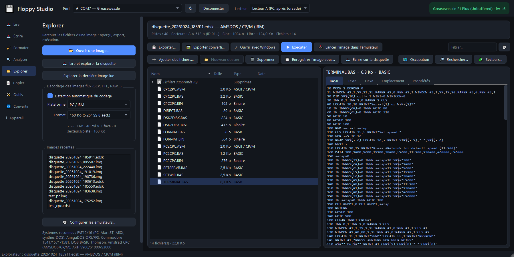

# Floppy Studio

Interface graphique moderne pour les lecteurs de flux **Greaseweazle** (et compatibles « gw-compat »).
Basée sur la bibliothèque officielle `greaseweazle` : mêmes formats, même fiabilité, en plus clair.



## Téléchargement

Dernière version : [page des versions](https://github.com/Darkmind64/Floppy-Studio/releases/latest)

- **`FloppyStudio_Setup_x.y.z.exe`** — installateur Windows 10/11 (menu Démarrer, icône de bureau,
  « Ouvrir avec » pour les images disquette, désinstallation propre).
- **`FloppyStudio_portable_x.y.z.exe`** — version portable, un seul fichier, rien à installer.

Branchez le Greaseweazle (pilote USB série natif de Windows), lancez le programme : le port est détecté
automatiquement. Les mêmes fonctions d'exploration et de conversion marchent sans lecteur, sur des images.

## Fonctions

- **Format actif unique** : choisi une seule fois dans la barre du haut (ou détecté automatiquement), il
  s'applique à toutes les pages (lecture, écriture, copie, formatage, explorateur, conversion).
- **Test de surface au formatage** : les pistes défectueuses sont isolées dans le système de fichiers (FAT,
  Amiga, Thomson, CPC) pour réutiliser une disquette abîmée.
- **Duplication en série** : une image écrite sur plusieurs disquettes à la suite, avec détection d'insertion.
- **Identification TOSEC / No-Intro** : import des fichiers DAT ; images et disquettes lues reconnues par
  empreinte, titres renommés automatiquement.
- **Archives .zip** : images ouvertes, écrites, converties et cataloguées sans extraction manuelle.
- **Pas double** pour les disquettes 40 pistes dans un lecteur 5,25" 80 pistes (détecté à l'analyse).
- **Actions suivantes** proposées après chaque lecture, écriture ou conversion (explorer, ouvrir le dossier,
  récupérer les secteurs illisibles, écrire une copie…).
- **Lire** une disquette vers une image (IMG, ADF, ST, FD, D64, IMD, EDSK, HFE, SCP…) avec relectures,
  repositionnement de tête et copie flux brut optionnelle (.scp) à côté de l'image.
- **Écrire** une image sur disquette avec vérification piste par piste ; format deviné d'après l'extension
  ou la taille du fichier.
- **Analyser** : identifie automatiquement le format (PC, Thomson, Amiga, Atari ST, Akai, Ensoniq…),
  la vitesse et la densité.
- **Carte de la disquette** en direct : vue grille ou vue disque, secteur par secteur, info-bulles,
  histogramme des intervalles de flux par piste.
- **Outils** : mesure de vitesse (courbe + verdict), positionnement de tête, nettoyage, effacement,
  réinitialisation, vérification et mise à jour du firmware.
- **Formater** : FAT PC 360 Ko → 2,88 Mo, Atari ST, MSX, synthés DOS, AmigaDOS OFS/FFS (DD/HD),
  DOS BASIC Thomson 1 ou 2 faces, Amstrad CPC Data/Système, Commodore 1581, ou formatage bas niveau
  de n'importe quel format ; création d'images vierges.
- **Copier / vérifier** : copie de disquette (secteurs ou flux brut), comparaison disquette ↔ image,
  test de surface, récupération multi-passes des secteurs illisibles, fusion de plusieurs lectures.
- **Qualité et protections** : qualité du signal piste par piste (vue « Santé »), fiche détaillée des
  secteurs (ID, taille, CRC), détection des protections (secteurs faibles, tailles non standard, IDs
  falsifiés, pistes longues, CRC volontaires…), analyse d'images flux sans lecteur, rapport HTML / PDF.
- **Lecture par lot** avec détection de l'insertion, **profils de lecture**, flux brut conservé et
  re-décodable, **calibrage** du lecteur en direct.
- **Catalogue** de la collection : recherche dans les titres, notes et noms de fichiers de toutes les
  images, doublons (images et fichiers), export CSV.
- **Comparaison de deux images** piste par piste et fusion des meilleures lectures.
- Interface en **français ou anglais**, **thème sombre ou clair**, raccourcis clavier, aide intégrée (F1),
  **mises à jour automatiques** depuis GitHub.
- **Convertir** entre formats d'image sans le lecteur.
- **Explorer** les fichiers d'une image ou de la disquette insérée : arborescence, aperçu (texte avec
  jeux de caractères au choix, listings BASIC Locomotive (CPC), Thomson, MSX, GW-BASIC et C64, images IFF/PCX/Degas/NEO/écran CPC/Koala, sons WAV/8SVX/
  samples Akai, hexadécimal + texte / hexa seul / texte seul), export (y compris glisser-déposer vers l'Explorateur Windows et export
  converti PNG/WAV/TXT), ouverture avec l'application Windows associée, exécution dans un émulateur
  (DOSBox, Hatari, WinUAE, VICE, WinAPE, DCMOTO, openMSX — configurables).
  Systèmes de fichiers : FAT12/16 (PC, Atari ST, MSX, synthés DOS), AmigaDOS OFS/FFS, Commodore
  1541/1571/1581, DOS BASIC Thomson, Amstrad CPC (AMSDOS/CP/M), Apple II DOS 3.3 / ProDOS,
  Akai S900/S1000/S3000 (expérimental). Conteneurs : IMG, ST, MSA, ADF, D64/D81, FD, DSK/EDSK, IMD,
  TD0, DMK, DO/PO/2MG, HFE, SCP, KryoFlux.
  Ajout / suppression de fichiers et dossiers (FAT avec noms longs, CPC, Amiga, Thomson, Commodore),
  enregistrement de l'image ou écriture directe sur la disquette ; carte d'occupation du volume,
  fichiers supprimés récupérables, recherche texte/hexa, éditeur de secteurs, désassembleur
  (Z80, 6809, 6502, 68000, x86), en-têtes d'exécutables ; la carte s'exporte en PNG.
- **Conversions de fichiers** : listing texte → BASIC tokenisé (CPC, MSX, GW-BASIC), image → écran CPC
  (modes 0/1/2 avec chargeur), WAV → sample Akai S1000.
  Les secteurs illisibles sont signalés fichier par fichier ; une FAT ou un secteur de démarrage
  détruits sont contournés quand c'est possible.

Plateformes prêtes à l'emploi : PC/IBM, Thomson TO/MO, Amiga, Atari ST, Commodore, Amstrad CPC
(scan IBM → EDSK), sampleurs & synthés (Akai S900/S1000/S3000, Ensoniq EPS/ASR/Mirage, formats DOS),
Apple II, Mac, Acorn, MSX, ZX Spectrum, PC-98, etc. (tous les formats `diskdefs` de Greaseweazle).

## Installation (source)

```bat
pip install PySide6 pyserial capstone
pip install https://github.com/keirf/greaseweazle/archive/refs/heads/master.zip
run.bat
```

La bibliothèque greaseweazle compile une petite extension C : il faut les Build Tools Visual Studio
avec le SDK Windows (sinon les formats Mac GCR ne sont pas disponibles).

## Construire

```bat
build.bat
```

Produit `dist\FloppyStudio.exe` (portable) et, si [Inno Setup 6](https://jrsoftware.org/isinfo.php) est
installé, `installer\FloppyStudio_Setup_x.y.z.exe`.

## Licence

Floppy Studio : MIT. La bibliothèque Greaseweazle (Keir Fraser) est dans le domaine public (Unlicense).
